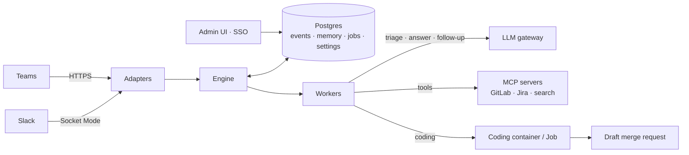

<p align="center">
  
</p>

<h1 align="center">Heinzel</h1>

<p align="center">
  <strong>A self-hosted AI teammate for Slack and Microsoft Teams.</strong><br>
  Tag it and it works in the thread. Or let it follow a channel and speak up on its own when it can clearly help.
</p>

<p align="center">
  <a href="https://github.com/v0lumehi/heinzel/actions/workflows/ci.yml"></a>
  <a href="https://codecov.io/gh/v0lumehi/heinzel"></a>
  <a href="https://github.com/v0lumehi/heinzel/actions/workflows/codeql.yml"></a>
  <a href="https://www.bestpractices.dev/projects/15626"></a>
  <a href="https://scorecard.dev/viewer/?uri=github.com/v0lumehi/heinzel"></a>
  <a href="https://github.com/v0lumehi/heinzel/releases"></a>
  <a href="LICENSE"></a>
</p>

<p align="center">
  <a href="#quick-start">Quick start</a> ·
  <a href="docs/DEPLOYMENT.md">Deployment</a> ·
  <a href="#documentation">Documentation</a> ·
  <a href="docs/ROADMAP.md">Roadmap</a> ·
  <a href="CONTRIBUTING.md">Contributing</a>
</p>

---

## Why Heinzel

- **Your infrastructure, your data.** One container plus Postgres. Messages, memories and settings stay in your database. Only the LLM call leaves, through the gateway you choose.
- **Slack and Teams.** One product for both, so mixed or merging organisations get the same teammate everywhere.
- **Proactive, but polite.** Ambient mode is off by default and set per channel. A small model decides whether to speak. Budgets and cooldowns cap unprompted posts.
- **Any model.** Any OpenAI-compatible gateway (defaults to the [Requesty](https://requesty.ai) EU gateway). A small model triages, a mid-size model answers, an optional strong model takes hard tasks.
- **Team memory.** Remembers decisions, owners and conventions per channel, organisation-wide and per person.
- **Your tools.** Web pages, self-hosted search (SearXNG), GitLab, Jira, Confluence and any other [MCP](https://modelcontextprotocol.io) server.
- **Coding sessions.** Hands a task to a coding agent in an isolated container or Kubernetes Job in your infrastructure. The result is a draft merge request.
- **Built for operations.** Admin UI with single sign-on, roles and audit log. Helm chart. Signed multi-arch images with SBOM.

> **Status:** early. Tested with a real Slack workspace and a Microsoft Teams test tenant. Not yet run in production. See the [roadmap](docs/ROADMAP.md).

## How it behaves

| Situation | What Heinzel does |
|---|---|
| Someone tags `@Heinzel` or writes to it directly | Reacts with 👀, reads the thread (or recent history), answers in the thread |
| Someone replies in a thread Heinzel took part in | Decides whether the reply is meant for it. Answers if so |
| Ambient mode is on and nobody tagged Heinzel | Mostly stays quiet. May remember a fact, schedule a follow-up, or speak up |
| A question stays open or someone promises something | Schedules a follow-up and checks back later |
| A task is hard | Hands over to the strong model, within a daily budget |
| Someone asks for a code change | Proposes a coding session. It starts after the requester confirms with `!go` |

Chat commands (mention Heinzel first): `!status`, `!ambient on|off`, `!limit <n>`, `!instructions <text>`, `!memories [query]`, `!deep <question>`, `!go` / `!stop` / `!coding`, `!help`.

## How it works



Every slow step runs as a job in Postgres, so work survives restarts and several replicas share the load. Details: [docs/ARCHITECTURE.md](docs/ARCHITECTURE.md).

## Quick start

Requirements: Node 22+, pnpm, Docker (or any Postgres 14+), an API key for an OpenAI-compatible LLM gateway.

```bash
git clone https://github.com/v0lumehi/heinzel.git && cd heinzel
cp .env.example .env              # LLM_API_KEY, model ids, chat platform credentials
pnpm install
docker compose up -d postgres
pnpm build:web                    # admin UI
pnpm dev                          # migrates the database and connects
```

Then connect a chat platform:

- **Slack** (works from a laptop, no public URL): create the app from [`slack-app-manifest.yaml`](slack-app-manifest.yaml) on [api.slack.com/apps](https://api.slack.com/apps), set `SLACK_APP_TOKEN` (app-level token with `connections:write`) and `SLACK_BOT_TOKEN` (after *Install to Workspace*). Invite the bot with `/invite @Heinzel` and send `@Heinzel !help`.
- **Microsoft Teams:** try it without a tenant in the Agents Playground (`TEAMS_PLAYGROUND=true`), then connect a real tenant: [docs/TEAMS.md](docs/TEAMS.md).

The **admin UI** runs on http://localhost:3080 (`ADMIN_DEV_LOGIN=true` for a local sign-in button). Its *Setup* page walks you through Slack and Teams and checks the connection.

## Deployment

| | |
|---|---|
| Kubernetes | Helm chart `oci://ghcr.io/v0lumehi/charts/heinzel`: non-root, read-only root filesystem, probes, ingress, coding Jobs with RBAC, egress proxy and NetworkPolicy. [docs/DEPLOYMENT.md](docs/DEPLOYMENT.md) |
| Docker Compose | `docker compose --profile app up -d` for a single machine |
| Images | `ghcr.io/v0lumehi/heinzel`, `ghcr.io/v0lumehi/heinzel-coder` — amd64 and arm64, signed with cosign, with SBOM and provenance. [SECURITY.md](SECURITY.md) |
| Upgrades | Migrations run at startup. [CHANGELOG.md](CHANGELOG.md) says when you need to act |

## Documentation

| Topic | |
|---|---|
| Architecture and design decisions | [docs/ARCHITECTURE.md](docs/ARCHITECTURE.md) |
| Deployment, Helm, upgrades | [docs/DEPLOYMENT.md](docs/DEPLOYMENT.md) |
| Admin UI, single sign-on, settings | [docs/ADMIN.md](docs/ADMIN.md) |
| Microsoft Teams | [docs/TEAMS.md](docs/TEAMS.md) |
| Tools and MCP servers | [docs/TOOLS.md](docs/TOOLS.md) |
| Coding sessions | [docs/CODING.md](docs/CODING.md) |
| Configuration reference | [.env.example](.env.example) |
| Roadmap and open decisions | [docs/ROADMAP.md](docs/ROADMAP.md) |
| Releasing | [docs/RELEASING.md](docs/RELEASING.md) |

## Contributing

Issues and pull requests are welcome. Start with [CONTRIBUTING.md](CONTRIBUTING.md). Coding agents also read [AGENTS.md](AGENTS.md). Please report security issues privately as described in [SECURITY.md](SECURITY.md).

## License

Copyright 2026 v0lumehi. Licensed under the [Apache License 2.0](LICENSE).
